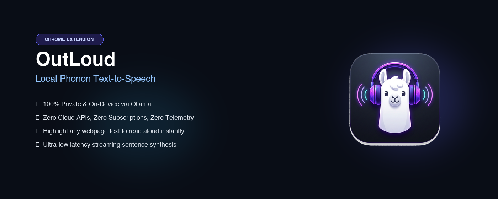
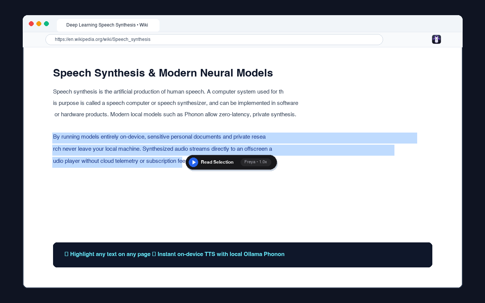
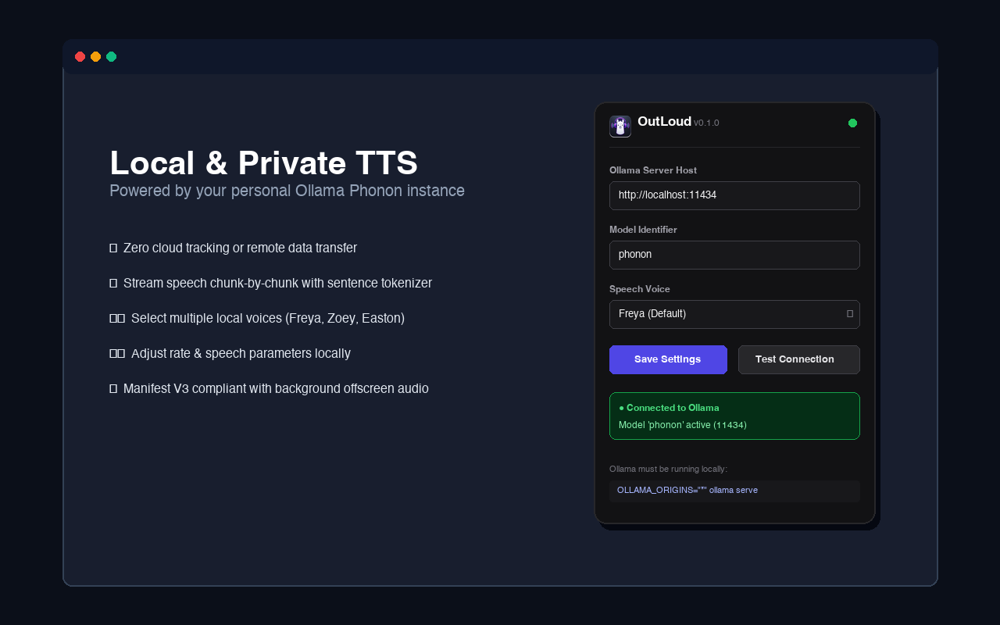
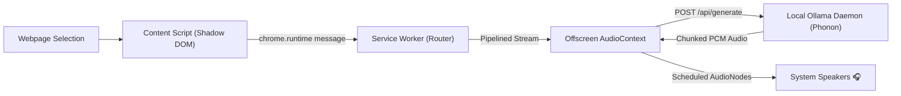

<p align="center">
  
</p>

# OutLoud

> **A Zero-Cost, 100% Private Neural Text-to-Speech Chrome Extension Powered by Local Ollama & Phonon**

[](https://chromewebstore.google.com/detail/ccbgbiimgikekfeeacgimhhbdchlfmpn)
[](manifest.json)
[](https://ollama.com/library/phonon)
[](#100-local--private-by-design)
[](LICENSE)
[](https://buymeacoffee.com/vyavahareyash)
[](https://github.com/sponsors/vyavahareyash)

OutLoud transforms any webpage into an instant, natural-sounding audiobook. Highlight text on any website to hear human-like speech synthesized on-device by your local [Phonon](https://ollama.com/library/phonon) neural speech synthesis model running on Ollama.

**Zero cloud subscriptions ($150–$300/yr saved). Zero latency waiting for buffers. Zero telemetry or data leakage.**

<p align="center">
  <b><a href="#quick-start">🚀 Quick Start</a></b> •
  <b><a href="#install-from-the-chrome-web-store">📦 CWS Install</a></b> •
  <b><a href="#why-outloud">💡 Why OutLoud</a></b> •
  <b><a href="#key-features">⚡ Features</a></b> •
  <b><a href="#architecture--audio-pipeline">🏗️ Architecture</a></b> •
  <b><a href="#support-development">☕ Support</a></b>
</p>

---

## Support Development

OutLoud is 100% free, private, and open-source with zero ads, zero trackers, and zero subscriptions. If OutLoud helps you read articles, research papers, or documentation hands-free, buying a coffee or sponsoring development is greatly appreciated!

<a href="https://buymeacoffee.com/vyavahareyash" target="_blank">
  
</a>

---

## Why OutLoud?

Reading long technical documentation, research papers, newsletters, and articles strains your eyes and saps focus. Existing web text-to-speech tools force painful compromises:

* 💸 **The SaaS Paywall Trap**: Cloud extensions like Speechify or NaturalReader lock natural-sounding voices behind \$10–\$30/month subscription paywalls.
* 🔒 **The Cloud Privacy Hazard**: Cloud readers upload every highlighted paragraph—including proprietary code, internal memos, personal emails, and financial reports—to remote third-party servers.
* 🤖 **The Robotic Browser Dilemma**: Free browser-native synthesizers (`window.speechSynthesis`) rely on legacy 1990s robotic voices lacking inflection, emotional nuance, or natural pacing.
* ⏳ **Buffer Latency**: Traditional generators require entire paragraphs to complete server-side synthesis before playback begins.

### The OutLoud Solution

OutLoud runs **100% edge-native**:
1. **Human-Quality Neural Audio**: Powered by the Phonon neural TTS model running locally via Ollama.
2. **True Confidentiality**: Selected text never leaves your localhost (`127.0.0.1`).
3. **Sub-Second Audio Playback**: Pipelined sentence tokenization and streaming Web Audio offscreen workers start playback within hundreds of milliseconds.
4. **Permanent Free Utility**: No monthly bills, no API tokens, no usage meters.

---

## Key Features

<p align="center">
  
  
</p>

- 🔊 **Instant Text-to-Speech**: Simply highlight text on any webpage. A floating audio pill automatically appears near your selection.
- ⚡ **Sub-Second Time-to-First-Audio (TTFA)**: Employs `Intl.Segmenter` boundary streaming to send sentence chunks to the neural pipeline, scheduling audio nodes seamlessly in real time.
- 🎯 **Isolated Shadow DOM**: The floating control renders inside a closed Shadow DOM, guaranteeing host page stylesheets never distort button styling or break interactive elements.
- 🎛️ **Granular Voice & Speed Control**: Pick from 4 distinct voice checkpoints (`default`, `Zoey`, `Easton`, `Freya`) and scale playback speed between `0.5x` and `2.0x`.
- ⏹️ **Deterministic Stop**: Clicking stop instantly aborts ongoing HTTP requests to Ollama and purges scheduled Web Audio buffers—no lagging audio tails.
- 🛡️ **100% Local & Private by Design**: Zero network egress, zero cookies, zero telemetry, and zero remote dependencies.

---

## Quick Start

### 1. Install from the Chrome Web Store

[](https://chromewebstore.google.com/detail/ccbgbiimgikekfeeacgimhhbdchlfmpn)

👉 **[Direct Link to Chrome Web Store](https://chromewebstore.google.com/detail/ccbgbiimgikekfeeacgimhhbdchlfmpn)**

---

### 2. Prerequisites (Ollama & Phonon)

OutLoud synthesizes audio using your local Ollama daemon.

1. **Install Ollama**: Download from [ollama.com](https://ollama.com).
2. **Pull the Phonon Model**:
   ```bash
   ollama pull phonon
   ```
3. **Launch Ollama with Extension Origins**:
   Chrome extensions communicate across origins (`chrome-extension://*`). Allow the extension to reach Ollama:

   **macOS / Linux:**
   ```bash
   OLLAMA_ORIGINS="*" ollama serve
   ```
   *(To persist across reboots on macOS: `launchctl setenv OLLAMA_ORIGINS "*"`)*

   **Windows (PowerShell):**
   ```powershell
   $env:OLLAMA_ORIGINS="*"
   ollama serve
   ```
   *(Or add `OLLAMA_ORIGINS` with value `*` in Windows System Environment Variables)*

---

### 3. Usage

1. Highlight any sentence or paragraph on any website.
2. Click the floating **Play** pill.
3. Click the extension toolbar icon to adjust playback rate or change your preferred voice.

---

## Architecture & Audio Pipeline

OutLoud utilizes Manifest V3 with an offscreen document architecture to bypass background service worker audio limitations while maintaining optimal system performance:



1. **Content Script**: Observes mouse selections without layout thrashing; spawns an isolated Shadow DOM pill.
2. **Sentence Chunking (`Intl.Segmenter`)**: Decomposes text into grammatical sentence boundaries for parallel pre-fetching.
3. **Offscreen Document**: Manages the Web Audio API `AudioContext` and dynamically queues audio buffers with sample-accurate scheduling.
4. **Ollama Integration**: Direct streaming connection to `http://localhost:11434` for continuous, glitch-free audio synthesis.

---

## Development & Contributing

### Setup

```bash
git clone https://github.com/vyavahareyash/outloud.git
cd outloud
npm install
```

### Verification & Testing

```bash
# Run unit & streaming test suite
npm test

# Type-check TypeScript sources
npm run type-check

# Run Biome linter & formatter checks
npm run lint
```

### Build Extension

```bash
# Development build
npm run build

# Production bundled build
npm run build:prod
```

### Load Unpacked in Chrome

1. Open Chrome and navigate to `chrome://extensions/`.
2. Toggle **Developer mode** in the upper right corner.
3. Click **Load unpacked** and select the repository's `dist/` directory.

---

## Privacy & Security

OutLoud strictly adheres to single-purpose design:
* All machine learning inference occurs strictly on `127.0.0.1:11434`.
* No remote analytics, tracking pixels, or diagnostic telemetry exist in the codebase.
* Webpage text is never written to disk or sent over any public internet route.
* Review our complete policy in [PRIVACY.md](PRIVACY.md).

---

## License

MIT © [Yash Vyavahare](LICENSE)
