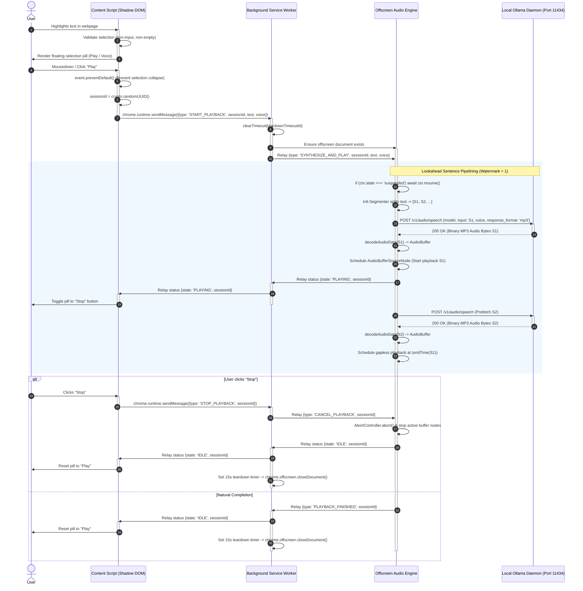

# OutLoud: Local Phonon Text-to-Speech Chrome Extension

* **Author:** Yash
* **Status:** In Review
* **Date:** 2026-11-02

---

## Overview

This document specifies OutLoud, a Manifest V3 Google Chrome extension that reads selected webpage text aloud using a local Ollama instance running the Phonon speech synthesis model. The extension isolates user interface controls within a Shadow DOM floating selection pill, relays user speech commands via the extension background service worker, executes client-side sentence chunking, streams audio requests to the local Ollama daemon (`http://localhost:11434`), and plays back speech using an on-demand Manifest V3 offscreen document running the Web Audio API.

The extension is designed for users who require offline text-to-speech without streaming page contents or reading selections to remote third-party cloud infrastructure.

## The Problem

Users reading dense documentation, research publications, or long-form web content frequently benefit from auditory playback to reduce cognitive fatigue and improve comprehension. Existing solutions suffer from three distinct drawbacks:

1. **Cloud Privacy Leaks**: Commercial browser extensions (e.g., Speechify, Read Aloud) transmit extracted text to remote cloud servers, violating privacy requirements when reading sensitive documents, internal wikis, or private correspondence.
2. **Robotic Native Browser Synthesis**: Built-in browser speech synthesis (`window.speechSynthesis`) often uses mechanical, platform-dependent system voices with poor prosody and unnatural intonation.
3. **Local LLM/TTS Complexity**: While open-source neural text-to-speech models (such as Phonon via Ollama) can run completely offline, using them currently requires manual terminal commands or piping text through CLI scripts, lacking direct integration into web reading workflows.

OutLoud bridges local TTS inference into Chrome by turning highlighted text into real-time spoken audio with zero cloud data transmission.

## Goals

* **Offline Privacy**: Execute all text-to-speech generation through a local Ollama daemon (`localhost:11434`) with zero network egress to external cloud services.
* **Low Time-to-First-Audio (TTFA)**: Start audio playback within 600ms of selection confirmation on modern desktop hardware by splitting text into sentences and pipelining generation and playback.
* **Non-Disruptive Selection UX**: Display an isolated Shadow DOM pill adjacent to text selection that avoids colliding with host page styles, intercepts pointer events to prevent selection collapse, and ignores editable input fields (`<input>`, `<textarea>`, `[contenteditable]`).
* **Deterministic Playback Control**: Provide immediate Play and Stop controls where Stop immediately aborts in-flight Ollama HTTP generation and clears active Web Audio buffers.
* **Configurable Voices**: Allow users to select and persist their preferred Phonon voice checkpoint from a supported catalog via an extension popup/options interface.
* **Actionable Daemon Feedback**: Detect and display explicit status when the Ollama daemon is offline, missing the Phonon model, or rejecting requests due to local CORS restrictions.

## Non-Goals

* **Full-Page Article Extraction**: The extension will not parse entire web pages, strip boilerplate, or provide an automated readability view. It operates strictly on text explicitly highlighted by the user.
* **Cloud API Fallbacks**: The extension will not fall back to remote cloud APIs (e.g., OpenAI, ElevenLabs, Google Cloud TTS) if the local Ollama instance is unreachable.
* **Audio File Exporting**: Saving or exporting synthesized speech as downloadable MP3 or WAV files is out of scope for the initial release.
* **Multi-Browser Cross-Platform Support**: Initial targeting is restricted to Google Chrome on desktop platforms (macOS, Linux, Windows) running Manifest V3. Firefox and mobile browsers are excluded.

## Resolved Design Decisions

* **Voice Discovery & Fallback Contract (Closed)**: Ollama does not expose a dedicated voice enumeration endpoint for Phonon. OutLoud maintains a static catalog of supported Phonon voices (`default`, `Zoey`, `Easton`, `Freya`), stores the user selection in `chrome.storage.sync`, and falls back to `"default"` if an unrecognized voice is specified.
* **OLLAMA_ORIGINS & CORS Configuration (Closed)**: Standard Ollama installations enforce CORS origin filtering. While Manifest V3 `host_permissions` bypass client webpage Content Security Policies, requests from the extension carry `Origin: chrome-extension://<id>`. To connect, users must launch Ollama with `OLLAMA_ORIGINS="*"` (or configure `OLLAMA_ORIGINS="chrome-extension://*"`). The extension health check detects CORS preflight failures and displays actionable configuration commands.

## Critical User Journeys (CUJs)

### CUJ 1: Highlight and Read Text Aloud

* **Given**: Chrome is open with the extension installed, Ollama is running locally with the `phonon` model pulled and `OLLAMA_ORIGINS="*"` configured, and the user has selected a valid voice in settings.
* **When**: The user highlights a paragraph of text on any web page.
* **Then**: A floating pill appears directly above or below the selection. Clicking "Play" initiates sentence-pipelined generation; audio playback begins within 600ms, and the pill toggles to a "Stop" state.

### CUJ 2: Premature Playback Cancellation

* **Given**: Audio is actively playing through the offscreen document for a 500-word selection.
* **When**: The user clicks the "Stop" button in the floating pill, or deselects text by clicking outside.
* **Then**: Active audio output immediately halts, all scheduled Web Audio buffer nodes are stopped, pending HTTP fetch requests to Ollama are aborted via `AbortController`, and the offscreen document transitions to idle.

### CUJ 3: Graceful Daemon Connection Error

* **Given**: The user highlights text while the Ollama daemon is shut down, port 11434 is blocked, or CORS preflight is rejected.
* **When**: The user clicks "Play".
* **Then**: The floating pill displays an inline error message (e.g., "Ollama offline or CORS rejected. Run OLLAMA_ORIGINS='*' ollama serve"), prevents hung loading spinners, resets to "Play", and preserves host page stability.

---

## Technical Plan (Architecture)

### Architectural Overview

OutLoud utilizes a distributed Manifest V3 architecture comprising four distinct execution contexts:

1. **Content Script Context (`src/content/`)**: Injected into web pages. Observes DOM text selection events, enforces input exclusion rules, renders an isolated Shadow DOM floating pill, intercepts `pointerdown` events to preserve selection focus, and translates user clicks into session-tagged messaging intents.
2. **Background Service Worker (`src/background/`)**: Operates as the central extension message bus. Coordinates offscreen document creation and teardown, manages teardown timer invalidation, routes audio jobs, and queries Ollama daemon health.
3. **Offscreen Document Audio Engine (`src/offscreen/`)**: Hosts an authoritative `AudioContext` and playback state machine. Executes sentence chunking via `Intl.Segmenter`, issues HTTP requests to Ollama with lookahead watermarking (max 1 chunk ahead) and `AbortController`, decodes audio segments via `decodeAudioData`, and schedules gapless playback using `AudioBufferSourceNode`.
4. **Options & Popup Context (`src/popup/`)**: Provides user controls for configuring the Ollama server URL (default: `http://localhost:11434`), model identifier (default: `phonon`), preferred voice name, and testing daemon connectivity and CORS status.

### System Architecture Diagram



### Component Details

#### 1. Content Script & Shadow DOM Pill (`src/content/`)

* **Selection Boundary Invariants**: Listens to `selectionchange` and `mouseup`. The floating pill is only rendered if:
  * Selected text trimmed length is between 3 and 10,000 characters.
  * Active element is not an `HTMLInputElement`, `HTMLTextAreaElement`, or within a container with `contenteditable="true"` or `role="textbox"`.
* **Selection Focus Preservation**: The floating pill root container binds `mousedown` and `pointerdown` listeners with `event.preventDefault()`. This prevents the browser from collapsing the active DOM selection range when the user clicks the pill controls.
* **CSS & Asset Encapsulation**: All pill DOM nodes, SVG icons, and stylesheets are constructed in-memory and attached inside a closed Shadow Root (`container.attachShadow({mode: 'closed'})`). This eliminates the need for `web_accessible_resources` and prevents extension fingerprinting by host scripts.
* **Repositioning Logic**: Calculates viewport coordinates using `window.getSelection().getRangeAt(0).getBoundingClientRect()`. Anchors the pill 8px above the start of the selection, flipping below if the top boundary exceeds viewport space.

#### 2. Service Worker Message Router & Lifecycle Manager (`src/background/`)

* **Offscreen Management**: Implements `ensureOffscreenDocument()` using `chrome.offscreen.hasDocument()` and `chrome.offscreen.createDocument({url: 'src/offscreen/offscreen.html', reasons: ['AUDIO_PLAYBACK'], justification: 'Synthesize and play speech via Web Audio API'})`.
* **Teardown Timer Invalidation**: Maintains `teardownTimeoutId: number | null`. Unconditionally executes `clearTimeout(teardownTimeoutId)` upon receiving a `START_PLAYBACK` message. Initiates a new 15-second timer upon receiving `PLAYBACK_FINISHED` or `CANCEL_PLAYBACK`.
* **Network Host Permissions**: Declares `"host_permissions": ["http://localhost:11434/*"]` in `manifest.json`.

#### 3. Offscreen Audio Engine & Pipeline Scheduling (`src/offscreen/`)

* **AudioContext Initialization & Autoplay Handling**: Lazily creates the `AudioContext`. Prior to scheduling playback, verifies state and resumes if necessary:
  ```typescript
  if (this.audioContext.state === 'suspended') {
    await this.audioContext.resume();
  }
  ```
* **Sentence-Boundary Tokenization**: Uses the native `Intl.Segmenter` API (`new Intl.Segmenter('en', { granularity: 'sentence' })`) to segment input text cleanly across abbreviations, quotes, and decimals without regex parsing bugs.
* **Lookahead Concurrency & Memory Management**:
  * Employs a sliding lookahead window with a watermark of 1. At any given moment, the engine decodes and buffers at most 1 sentence ahead of the actively playing sentence.
  * Tracks active source nodes in `activeSources: Set<AudioBufferSourceNode>`. Each node attaches an `onended` handler to unreference buffers and permit immediate garbage collection.
* **Gapless Scheduling Math**:
  ```typescript
  const startTime = Math.max(this.audioContext.currentTime, this.nextScheduledTime);
  sourceNode.start(startTime);
  this.nextScheduledTime = startTime + buffer.duration;
  ```
* **Timeout & Fail-Fast Signal**: Wraps Ollama fetch requests with combined abort signals:
  ```typescript
  const signal = AbortSignal.any([userAbortController.signal, AbortSignal.timeout(15000)]);
  ```
* **Error State Machine**: On network, timeout, or decode failure, the engine calls `abort()` on the controller, stops all scheduled source nodes, broadcasts `{ type: 'PLAYBACK_STATUS_UPDATE', sessionId, state: 'ERROR', errorMessage }`, and resets its internal timeline to `0`.

#### 4. Communication Protocol & Message Schema

All runtime messages between contexts adhere to a tagged union format defined in `src/common/types.ts`:

```typescript
export interface OllamaSpeechRequest {
  model: string;
  input: string;
  voice?: string;
  response_format?: 'mp3' | 'wav';
}

export type PlaybackState = 'IDLE' | 'BUFFERING' | 'PLAYING' | 'ERROR';

export type ExtensionMessage =
  | { type: 'START_PLAYBACK'; sessionId: string; text: string; voice?: string }
  | { type: 'STOP_PLAYBACK'; sessionId: string }
  | { type: 'SYNTHESIZE_AND_PLAY'; sessionId: string; text: string; voice: string }
  | { type: 'CANCEL_PLAYBACK'; sessionId: string }
  | { type: 'PLAYBACK_STATUS_UPDATE'; sessionId: string; state: PlaybackState; errorMessage?: string }
  | { type: 'CHECK_DAEMON_HEALTH' }
  | { type: 'DAEMON_HEALTH_STATUS'; isOnline: boolean; hasModel: boolean; corsValid: boolean; errorMessage?: string };
```

---

## Alternatives Considered

### Alternative 1: Direct Content Script Audio Playback (No Offscreen Document)

* **Architecture**: The content script directly issues `fetch('http://localhost:11434/v1/audio/speech')` and instantiates an `AudioContext` or `HTMLAudioElement` inside the host web page DOM.
* **Pros**: Eliminates the need for `chrome.offscreen` management and simplifies runtime message routing between contexts.
* **Cons**:
  * **Strict Host CSP Violations**: Modern secure websites enforce restrictive `connect-src` directives that prevent scripts from fetching `http://localhost:11434`.
  * **Tab Navigation Interruption**: Any page reload, link click, or tab closure instantly terminates playback.
  * **DOM Contamination**: Host page scripts could detect, mute, or hijack extension audio elements.
* **Reason for Rejection**: Violates the principle of reliable playback across reading sessions and fails on all sites enforcing restrictive CSPs.

### Alternative 2: MediaSource Extensions (MSE) or AudioWorklet Byte-Streaming

* **Architecture**: Stream raw binary chunks from the Ollama response stream into an MSE `SourceBuffer` or pass raw PCM chunks into an `AudioWorkletNode` ring buffer.
* **Pros**: Sub-sentence time-to-first-audio latency by beginning playback as soon as the first few audio frames arrive over the wire.
* **Cons**:
  * **Decoding Fragility**: `MediaSource` handling of streaming MP3 or WAV container bytes frequently encounters buffer parsing errors when chunks split across audio frame boundaries.
  * **Payload Overhead / Codec Complexity**: AudioWorklet requires uncompressed PCM (which increases byte transfer size) or bundling a custom WebAssembly audio decoder (e.g., Opus/LAME) inside the extension.
  * **Cancellation Complexity**: Flushing partially buffered raw audio chunks in AudioWorklets is error-prone.
* **Reason for Rejection**: Architectural over-engineering. Sentence-level chunking achieves low perceived latency without custom WebAssembly codecs or fragile MSE buffer splicing.

### Alternative 3: Native Browser SpeechSynthesis API

* **Architecture**: Rely entirely on Chrome's built-in `window.speechSynthesis` API without Ollama or local model inference.
* **Pros**: Zero dependencies, zero installation, no daemon process, and zero GPU/CPU load.
* **Cons**: Robotic, mechanical prosody; inconsistent voice availability across operating systems; lack of support for modern open-weights neural speech architectures.
* **Reason for Rejection**: Directly contradicts the core project requirement to leverage the local Phonon neural speech model.

### Alternative 4: Monolithic Single-Request Audio Synthesis

* **Architecture**: Submit the entire highlighted text block to Ollama in a single HTTP request and wait for full audio generation before starting playback.
* **Pros**: Simplifies offscreen logic by removing sentence tokenization and buffer scheduling queues.
* **Cons**: High Time-to-First-Audio latency. For a 1,000-word article, the user experiences several seconds of silence before playback starts.
* **Reason for Rejection**: Unacceptable reading latency for long selections; pipelining sentence chunks provides responsive playback.

---

## Non-Functional Requirements

### Security & Privacy

* **Zero Cloud Egress**: The extension manifests strictly limit external network communication to `"http://localhost:11434/*"`. No telemetry, analytics, or text snippets are transmitted outside the user's workstation.
* **CSS & DOM Encapsulation**: The floating selection pill is encapsulated in a closed Shadow Root to ensure page scripts cannot read user interaction state or alter pill styling.
* **Input Field Protection**: Selection events originating within password fields, inputs, textareas, or content-editable elements are ignored to prevent accidental capture of private or credentials data.

### Performance & Latency

* **Time-to-First-Audio**: Sentence-pipelined generation ensures the first sentence chunk (typically 10-25 words) is synthesized, decoded, and scheduled within 600ms on modern hardware.
* **Memory Footprint**: The offscreen document is ephemeral; it is created on demand and automatically destroyed after 15 seconds of inactivity. Lookahead buffer depth is capped at 1 chunk, and finished nodes are immediately dereferenced on playback completion. Total extension memory footprint remains below 40MB during active playback.
* **Resource Cleanup**: Active audio buffer sources and in-flight fetch operations are explicitly halted upon user cancellation to prevent CPU/GPU exhaustion on the local machine.

---

## Additional Resources

* **Ollama Audio Documentation**: OpenAI-compatible speech endpoint specification (`POST /v1/audio/speech`).
* **Chrome Extensions Manifest V3 Offscreen API**: `chrome.offscreen` API documentation and best practices for audio playback.
* **Web Audio API Specification**: `AudioContext`, `decodeAudioData`, and `AudioBufferSourceNode` scheduling patterns.

---

## Detailed Implementation Plan

### Target Files to Create/Modify

#### 1. `manifest.json` (Create)
* **Type / Scope**: Manifest V3 Extension Configuration.
* **Proposed Changes**:
  * Set `manifest_version: 3`, `name: "OutLoud - Local Phonon TTS"`, version: `"0.1.0"`.
  * Define `background.service_worker: "dist/background/service-worker.js"`.
  * Declare permissions: `["offscreen", "storage"]`. (Note: `activeTab` deleted per ACT-15).
  * Declare host permissions: `["http://localhost:11434/*"]`.
  * Configure content scripts for `<all_urls>` loading `dist/content/content.js`.
  * Declare `action.default_popup: "src/popup/popup.html"`.

#### 2. `package.json` (Create)
* **Type / Scope**: Project build and dependency manifest.
* **Proposed Changes**:
  * Define name as `"outloud"`.
  * Define build and test scripts (`build`, `watch`, `test`, `type-check`, `lint`).
  * Add dev dependencies: `typescript`, `esbuild`, `vitest`, `@types/chrome`.

#### 3. `build.mjs` (Create)
* **Type / Scope**: Multi-entrypoint ESBuild script for Chrome MV3.
* **Proposed Changes**:
  * Configure separate bundle entrypoints targeting `dist/`:
    * `src/content/content.ts` -> `dist/content/content.js`
    * `src/background/service-worker.ts` -> `dist/background/service-worker.js`
    * `src/offscreen/offscreen.ts` -> `dist/offscreen/offscreen.js`
    * `src/popup/popup.ts` -> `dist/popup/popup.js`
  * Copy static assets (`manifest.json`, `src/popup/popup.html`, `src/popup/popup.css`, `src/offscreen/offscreen.html`) into `dist/`.

#### 4. `tsconfig.json` (Create)
* **Type / Scope**: TypeScript compiler configuration.
* **Proposed Changes**:
  * Target `ES2022`, module `ESNext`, moduleResolution `bundler`, strict mode enabled, DOM and WebWorker library types enabled.

#### 5. `biome.json` (Create)
* **Type / Scope**: Code formatting and linting configuration.
* **Proposed Changes**:
  * Configure 2-space indentation, strict linting rules, and ignore `dist/` and `node_modules/`.

#### 6. `src/common/types.ts` (Create)
* **Type / Scope**: Shared TypeScript interfaces and schemas.
* **Proposed Changes**:
  * Define `OllamaSpeechRequest` interface (`model`, `input`, `voice`, `response_format`).
  * Define `ExtensionMessage` discriminated union schema with required `sessionId: string` across start/stop intents.
  * Define `PlaybackState` enum (`IDLE`, `BUFFERING`, `PLAYING`, `ERROR`).
  * Define `ExtensionConfig` interface (`ollamaHost`, `modelName`, `selectedVoice`).
  * Define `SUPPORTED_VOICES = ['default', 'Zoey', 'Easton', 'Freya'] as const`.

#### 7. `src/common/config.ts` (Create)
* **Type / Scope**: Configuration and persistence utilities.
* **Proposed Changes**:
  * Provide `getConfig(): Promise<ExtensionConfig>` and `saveConfig(config: Partial<ExtensionConfig>): Promise<void>` wrapping `chrome.storage.sync` with defaults (`http://localhost:11434`, `phonon`, `default`).

#### 8. `src/content/content.ts` (Create)
* **Type / Scope**: Content script DOM observer and selection coordinator.
* **Proposed Changes**:
  * Attach debounced event listeners on `mouseup`, `keyup`, and `selectionchange`.
  * Enforce input exclusion (`isEditableElement(target: Node): boolean`).
  * On "Play" action, generate `sessionId = crypto.randomUUID()` and dispatch `START_PLAYBACK` message.
  * Forward `PLAYBACK_STATUS_UPDATE` messages to the floating pill.

#### 9. `src/content/pill.ts` (Create)
* **Type / Scope**: UI component for the floating action pill.
* **Proposed Changes**:
  * Instantiate `#outloud-selection-pill-root` with closed Shadow Root.
  * Intercept `mousedown` and `pointerdown` via `event.preventDefault()` to prevent selection collapse.
  * Inline SVG icons and CSS styles directly in TypeScript to eliminate `web_accessible_resources`.
  * Render Play/Stop buttons, loading spinner, and error status tooltip.

#### 10. `src/background/service-worker.ts` (Create)
* **Type / Scope**: Extension background event listener and lifecycle coordinator.
* **Proposed Changes**:
  * Track `teardownTimeoutId: number | null`.
  * On `START_PLAYBACK`: call `clearTimeout(teardownTimeoutId)` and invoke `ensureOffscreenDocument()`.
  * On `STOP_PLAYBACK` / `PLAYBACK_FINISHED`: schedule 15-second idle teardown timer.
  * Implement `checkDaemonHealth()` querying `GET http://localhost:11434/api/tags` and validating CORS headers.

#### 11. `src/offscreen/offscreen.html` (Create)
* **Type / Scope**: Minimal DOM wrapper for offscreen execution.
* **Proposed Changes**:
  * Minimal HTML importing `offscreen.js`.

#### 12. `src/offscreen/offscreen.ts` (Create)
* **Type / Scope**: Offscreen document message receiver and orchestrator.
* **Proposed Changes**:
  * Listen for `SYNTHESIZE_AND_PLAY` and `CANCEL_PLAYBACK` messages from the service worker.
  * Instantiate `AudioPlayer` and coordinate text tokenization and queue scheduling.
  * Post progress updates (`BUFFERING`, `PLAYING`, `IDLE`, `ERROR`) back to service worker.

#### 13. `src/offscreen/sentence-tokenizer.ts` (Create)
* **Type / Scope**: Text segmentation utility.
* **Proposed Changes**:
  * Implement `tokenizeSentences(text: string): string[]` using `new Intl.Segmenter('en', { granularity: 'sentence' })`.
  * Filter whitespace and enforce a 500-character sentence cap to prevent oversized chunks.

#### 14. `src/offscreen/audio-player.ts` (Create)
* **Type / Scope**: Web Audio engine and Ollama HTTP streaming client.
* **Proposed Changes**:
  * Maintain singleton `AudioContext`, ensuring `resume()` is called if suspended.
  * Implement sequential lookahead fetching (watermark = 1) with `AbortSignal.any([userAbortSignal, AbortSignal.timeout(15000)])`.
  * Convert binary responses into `AudioBuffer` via `decodeAudioData()`.
  * Manage `activeSources: Set<AudioBufferSourceNode>`, deregistering buffers via `.onended`.
  * Implement `cancel()` aborting in-flight HTTP requests, stopping active buffer nodes, and resetting timeline.

#### 15. `src/popup/popup.html` (Create)
* **Type / Scope**: Extension popup UI markup.
* **Proposed Changes**:
  * Form fields: Ollama Host input, Model name input, Voice dropdown (`default`, `Zoey`, `Easton`, `Freya`), and "Check Connection" button.
  * Status card showing daemon connectivity and actionable instructions for `OLLAMA_ORIGINS="*"`.

#### 16. `src/popup/popup.ts` (Create)
* **Type / Scope**: Options and popup logic.
* **Proposed Changes**:
  * Load and save settings to `chrome.storage.sync`.
  * Run connection and CORS checks against `http://localhost:11434/api/tags` and render active status indicator.

#### 17. `src/popup/popup.css` (Create)
* **Type / Scope**: Styling for the popup interface.
* **Proposed Changes**:
  * Compact form typography, responsive button states, and connection badge colors.

#### 18. `tests/setup.ts` (Create)
* **Type / Scope**: Vitest test environment initialization.
* **Proposed Changes**:
  * Mock `AudioContext`, `AudioBuffer`, and `AudioBufferSourceNode` using in-memory stubs.
  * Mock `chrome.runtime` and `chrome.storage` APIs.

#### 19. `tests/sentence-tokenizer.test.ts` (Create)
* **Type / Scope**: Unit tests for sentence segmentation.
* **Proposed Changes**:
  * Verify `Intl.Segmenter` segmentation across abbreviations, decimals, quotes, and ellipses.

#### 20. `tests/audio-player.test.ts` (Create)
* **Type / Scope**: Unit tests for audio scheduling, lookahead prefetching, and cancellation.
* **Proposed Changes**:
  * Verify `cancel()` stops in-flight fetches and cancels buffer nodes.
  * Verify `activeSources` Set cleanup on `ended` events.
  * Verify `nextScheduledTime` timeline drift calculation.

#### 21. `README.md` (Create)
* **Type / Scope**: Project documentation.
* **Proposed Changes**:
  * Document mandatory setup: `ollama pull phonon` and `OLLAMA_ORIGINS="*" ollama serve`.
  * Developer guide: `npm install`, `npm run build`, and loading unpacked extension into Chrome.

---

### Verification Plan

* **Compilation/Build**:
  * `npm run build`: Verify `esbuild` compiles all four entrypoints into `dist/` with zero diagnostics.
* **Unit Tests**:
  * `npm test`: Execute Vitest test suite with mock Web Audio environment (target 90%+ branch coverage).
* **Static Analysis & Linting**:
  * `npm run type-check`: Strict TypeScript type-check passing with zero `any` leaks.
  * `npm run lint`: Biome lint check passing with zero warnings.
* **Manual Integration & E2E Validation**:
  1. Start Ollama daemon with CORS enabled (`OLLAMA_ORIGINS="*" ollama serve`).
  2. Load unpacked extension from `dist/` into Chrome (`chrome://extensions`).
  3. Open options popup; verify connection check succeeds.
  4. Highlight a sentence on a web page; click "Play" and verify selection does not collapse. Verify audio begins within 600ms.
  5. Click "Stop" mid-playback; verify sound cuts out immediately and Ollama request is aborted.
  6. Highlight text inside `<input>` or `<textarea>`; verify pill is not rendered.

---

*Drafted with EGM*
