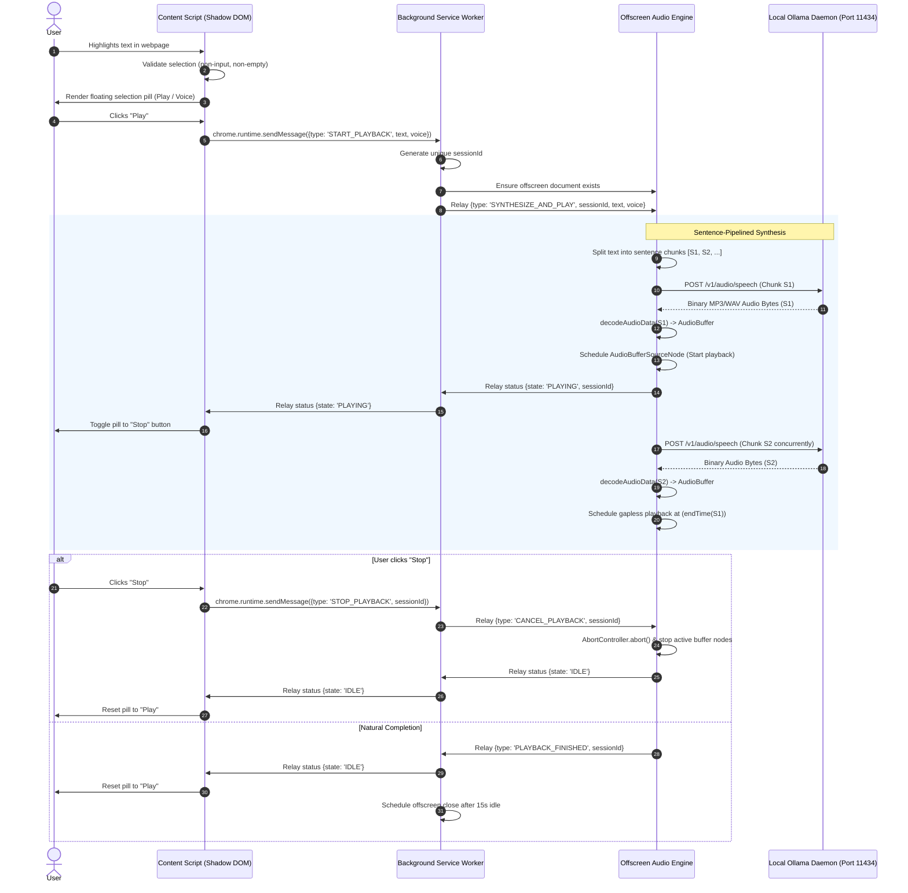

# OutLoud: Local Phonon Text-to-Speech Chrome Extension

* **Author:** Yash
* **Status:** Draft
* **Date:** 2026-11-02

---

## Overview

This document specifies OutLoud, a Manifest V3 Google Chrome extension that reads selected webpage text aloud using a local Ollama instance running the Phonon speech synthesis model. The extension isolates user interface controls within a Shadow DOM floating selection pill, relays user speech commands via the extension background service worker, executes client-side sentence chunking, streams audio requests to the local Ollama daemon (`http://localhost:11434`), and plays back speech using an on-demand Manifest V3 offscreen document running the Web Audio API.

The extension is designed for users who require offline, private text-to-speech without streaming page contents or reading selections to remote third-party cloud infrastructure.

## The Problem

Users reading dense documentation, research publications, or long-form web content frequently benefit from auditory playback to reduce cognitive fatigue and improve comprehension. Existing solutions suffer from three distinct drawbacks:

1. **Cloud Privacy Leaks**: Commercial browser extensions (e.g., Speechify, Read Aloud) transmit extracted text to remote cloud servers, violating privacy requirements when reading sensitive documents, internal wikis, or private correspondence.
2. **Robotic Native Browser Synthesis**: Built-in browser speech synthesis (`window.speechSynthesis`) often uses mechanical, platform-dependent system voices with poor prosody and unnatural intonation.
3. **Local LLM/TTS Complexity**: While open-source neural text-to-speech models (such as Phonon via Ollama) can run completely offline, using them currently requires manual terminal commands or piping text through CLI scripts, lacking direct integration into web reading workflows.

OutLoud bridges local TTS inference into Chrome by turning highlighted text into real-time spoken audio with zero data egress.

## Goals

* **Offline Privacy**: Execute all text-to-speech generation through a local Ollama daemon (`localhost:11434`) with zero network egress to external cloud services.
* **Low Time-to-First-Audio (TTFA)**: Start audio playback within 600ms of selection confirmation on capable local hardware by splitting text into sentences and pipelining generation and playback.
* **Non-Disruptive Selection UX**: Display an isolated Shadow DOM pill adjacent to text selection that avoids colliding with host page styles and ignores editable input fields (`<input>`, `<textarea>`, `[contenteditable]`).
* **Deterministic Playback Control**: Provide immediate Play and Stop controls where Stop immediately aborts in-flight Ollama HTTP generation and clears active Web Audio buffers.
* **Configurable Voices**: Allow users to select and persist their preferred Phonon voice checkpoint via an extension popup/options interface.
* **Actionable Daemon Feedback**: Detect and display explicit status when the Ollama daemon is offline or the Phonon model is missing from the local model registry.

## Non-Goals

* **Full-Page Article Extraction**: The extension will not parse entire web pages, strip boilerplate, or provide an automated readability view. It operates strictly on text explicitly highlighted by the user.
* **Cloud API Fallbacks**: The extension will not fall back to remote cloud APIs (e.g., OpenAI, ElevenLabs, Google Cloud TTS) if the local Ollama instance is unreachable.
* **Audio File Exporting**: Saving or exporting synthesized speech as downloadable MP3 or WAV files is out of scope for the initial release.
* **Multi-Browser Cross-Platform Support**: Initial targeting is restricted to Google Chrome on desktop platforms (macOS, Linux, Windows) running Manifest V3. Firefox and mobile browsers are excluded.

## Open Questions

* **Voice Discovery Contract**: Ollama does not currently expose a dedicated `/v1/audio/voices` enumeration endpoint. Should the extension maintain a curated list of standard Phonon voices (e.g., `default`, `Zoey`, `Easton`, `Freya`), or query model details via `/api/show`?
* **OLLAMA_ORIGINS Configuration**: Default Ollama installations bind to `127.0.0.1:11434` with restrictive CORS. Does standard Ollama accept requests originating from `chrome-extension://<id>` without requiring the user to launch Ollama with `OLLAMA_ORIGINS="*"`?

## Critical User Journeys (CUJs)

### CUJ 1: Highlight and Read Text Aloud

* **Given**: Chrome is open with the extension installed, Ollama is running locally with the `phonon` model pulled, and the user has selected a valid voice in settings.
* **When**: The user highlights a paragraph of text on any web page.
* **Then**: A floating pill appears directly above or below the selection. Clicking "Play" initiates sentence-pipelined generation; audio playback begins within seconds, and the pill toggles to a "Stop" state.

### CUJ 2: Premature Playback Cancellation

* **Given**: Audio is actively playing through the offscreen document for a 500-word selection.
* **When**: The user clicks the "Stop" button in the floating pill, or deselects text by clicking outside.
* **Then**: Active audio output immediately halts, all scheduled Web Audio buffer nodes are stopped, pending HTTP fetch requests to Ollama are aborted via `AbortController`, and the offscreen document transitions to idle.

### CUJ 3: Graceful Daemon Connection Error

* **Given**: The user highlights text while the Ollama daemon is shut down or port 11434 is blocked.
* **When**: The user clicks "Play".
* **Then**: The floating pill displays an inline error message ("Ollama offline at localhost:11434. Verify daemon is running."), prevents hung loading spinners, and does not crash the page or extension runtime.

---

## Technical Plan (Architecture)

### Architectural Overview

OutLoud utilizes a distributed Manifest V3 architecture comprising four distinct execution contexts:

1. **Content Script Context (`src/content/`)**: Injected into web pages. Observes DOM text selection events, enforces input exclusion rules, renders an isolated Shadow DOM floating pill, and translates user clicks into extension messaging intents.
2. **Background Service Worker (`src/background/`)**: Operates as the central extension message bus. Coordinates offscreen document creation and teardown, routes audio jobs, manages playback session state, and queries Ollama daemon health.
3. **Offscreen Document Audio Engine (`src/offscreen/`)**: Hosts a persistent `AudioContext` capable of decoding binary audio and rendering hardware audio output. Executes client-side sentence chunking, issues HTTP requests to Ollama with `AbortController`, decodes audio segments via `decodeAudioData`, and schedules gapless playback using `AudioBufferSourceNode`.
4. **Options & Popup Context (`src/popup/`)**: Provides user controls for configuring the Ollama server URL (default: `http://localhost:11434`), model identifier (default: `phonon`), preferred voice name, and testing daemon connectivity.

### System Architecture Diagram



### Component Details

#### 1. Content Script & Shadow DOM Pill (`src/content/`)

* **Selection Boundary Invariants**: Listens to `selectionchange` and `mouseup`. The floating pill is only rendered if:
  * Selected text trimmed length is between 3 and 10,000 characters.
  * Active element is not an `HTMLInputElement`, `HTMLTextAreaElement`, or within a container with `contenteditable="true"` or `role="textbox"`.
* **CSS Isolation**: All pill DOM nodes are attached inside a closed Shadow Root (`container.attachShadow({mode: 'closed'})`). Host page CSS styles cannot leak into or alter the floating pill layout, and pill styles cannot modify page elements.
* **Repositioning Logic**: Calculates viewport coordinates using `window.getSelection().getRangeAt(0).getBoundingClientRect()`. Anchors the pill 8px above the start of the selection, flipping below if the top boundary exceeds viewport space.

#### 2. Service Worker Message Router & Lifecycle Manager (`src/background/`)

* **Offscreen Management**: Implements `ensureOffscreenDocument()` using `chrome.offscreen.hasDocument()` and `chrome.offscreen.createDocument({url: 'src/offscreen/offscreen.html', reasons: ['AUDIO_PLAYBACK'], justification: 'Synthesize and play speech via Web Audio API'})`.
* **Inactivity Teardown**: Initiates a 15-second timer upon receiving `PLAYBACK_FINISHED` or `CANCEL_PLAYBACK`. If no new playback request arrives within 15 seconds, invokes `chrome.offscreen.closeDocument()` to reclaim system memory.
* **Network Host Permissions**: Declares `"host_permissions": ["http://localhost:11434/*"]` in `manifest.json`. Because requests are issued within the extension's privileged origin, host webpage Content Security Policies (`connect-src`) do not apply.

#### 3. Offscreen Audio Engine & Pipeline Scheduling (`src/offscreen/`)

* **Sentence-Boundary Tokenization**: Splits input text into discrete sentences using Unicode-aware regular expressions:
  ```javascript
  const sentences = text.match(/[^.!?\n]+[.!?\n]+(?:\s+|$)|[^.!?\n]+$/g) || [text];
  ```
* **Concurrent Fetch & Gapless Scheduling**:
  * An internal queue worker fetches sentence audio chunks sequentially with an active `AbortController`.
  * As each chunk resolves, its `ArrayBuffer` is passed to `AudioContext.decodeAudioData()`.
  * The resulting `AudioBuffer` is scheduled via an `AudioBufferSourceNode`:
    ```javascript
    const startTime = Math.max(audioContext.currentTime, nextScheduledTime);
    sourceNode.start(startTime);
    nextScheduledTime = startTime + buffer.duration;
    ```
  * Chunk $N+1$ is fetched and decoded while Chunk $N$ is actively playing, eliminating perceptible gaps between sentences while keeping time-to-first-audio low.
* **Deterministic Abortion**: An active `playbackSession` object stores the current `AbortController`, reference to `audioContext`, and an array of all active/scheduled `AudioBufferSourceNode` references. Calling `cancel()` invokes `.abort()` on the controller, `.stop(0)` on all nodes, disconnects the audio graph, and resets `nextScheduledTime = 0`.

#### 4. Communication Protocol & Message Schema

All runtime messages between contexts adhere to a tagged union format:

```typescript
type ExtensionMessage =
  | { type: 'START_PLAYBACK'; text: string; voice?: string }
  | { type: 'STOP_PLAYBACK'; sessionId: string }
  | { type: 'SYNTHESIZE_AND_PLAY'; sessionId: string; text: string; voice: string }
  | { type: 'CANCEL_PLAYBACK'; sessionId: string }
  | { type: 'PLAYBACK_STATUS_UPDATE'; sessionId: string; state: 'IDLE' | 'BUFFERING' | 'PLAYING' | 'ERROR'; errorMessage?: string }
  | { type: 'CHECK_DAEMON_HEALTH' };
```

---

## Alternatives Considered

### Alternative 1: Direct Content Script Audio Playback (No Offscreen Document)

* **Architecture**: The content script directly issues `fetch('http://localhost:11434/v1/audio/speech')` and instantiates an `AudioContext` or `HTMLAudioElement` inside the host web page DOM.
* **Pros**: Eliminates the need for `chrome.offscreen` management and simplifies runtime message routing between contexts.
* **Cons**:
  * **Strict Host CSP Violations**: Modern secure websites (e.g., GitHub, banking portals, cloud dashboards) enforce restrictive `connect-src` directives that prevent scripts from fetching `http://localhost:11434`.
  * **Tab Navigation Interruption**: Any page reload, link click, or tab closure instantly terminates playback.
  * **DOM Contamination**: Host page scripts could detect, mute, or hijack extension audio elements.
* **Reason for Rejection**: Violates the principle of reliable playback across reading sessions and fails on all sites enforcing restrictive CSPs.

### Alternative 2: MediaSource Extensions (MSE) or AudioWorklet Byte-Streaming

* **Architecture**: Stream raw binary chunks from the Ollama response stream into an MSE `SourceBuffer` or pass raw PCM chunks into an `AudioWorkletNode` ring buffer.
* **Pros**: Sub-sentence time-to-first-audio latency by beginning playback as soon as the first few audio frames arrive over the wire.
* **Cons**:
  * **Decoding Fragility**: `MediaSource` handling of streaming MP3 or WAV container bytes frequently encounters buffer parsing errors when chunks split across audio frame boundaries.
  * **Payload Overhead / Codec Complexity**: AudioWorklet requires uncompressed PCM (which increases byte transfer size) or bundling a custom WebAssembly audio decoder (e.g., Opus/LAME) inside the extension.
  * **Cancellation Complexity**: Flushing partially buffered raw audio chunks in AudioWorklets is error-prone.
* **Reason for Rejection**: Architectural over-engineering. Sentence-level chunking achieves low perceived latency without custom WebAssembly codecs or fragile MSE buffer splicing.

### Alternative 3: Native Browser SpeechSynthesis API

* **Architecture**: Rely entirely on Chrome's built-in `window.speechSynthesis` API without Ollama or local model inference.
* **Pros**: Zero dependencies, zero installation, no daemon process, and zero GPU/CPU load.
* **Cons**: Robotic, mechanical prosody; inconsistent voice availability across operating systems; lack of support for modern open-weights neural speech architectures.
* **Reason for Rejection**: Directly contradicts the core project requirement to leverage the local Phonon neural speech model.

### Alternative 4: Monolithic Single-Request Audio Synthesis

* **Architecture**: Submit the entire highlighted text block to Ollama in a single HTTP request and wait for full audio generation before starting playback.
* **Pros**: Simplifies offscreen logic by removing sentence tokenization and buffer scheduling queues.
* **Cons**: High Time-to-First-Audio latency. For a 1,000-word article, the user experiences several seconds of silence before playback starts.
* **Reason for Rejection**: Unacceptable reading latency for long selections; pipelining sentence chunks provides responsive playback.

---

## Non-Functional Requirements

### Security & Privacy

* **Zero Cloud Egress**: The extension manifests strictly limit external network communication to `"http://localhost:11434/*"`. No telemetry, analytics, or text snippets are transmitted outside the user's workstation.
* **CSS & DOM Encapsulation**: The floating selection pill is encapsulated in a closed Shadow Root to ensure page scripts cannot read user interaction state or alter pill styling.
* **Input Field Protection**: Selection events originating within password fields, inputs, textareas, or content-editable elements are ignored to prevent accidental capture of private or credentials data.

### Performance & Latency

* **Time-to-First-Audio**: Sentence-pipelined generation ensures the first sentence chunk (typically 10-25 words) is synthesized, decoded, and scheduled within 600ms on Apple Silicon / dedicated GPU hardware.
* **Memory Footprint**: The offscreen document is ephemeral; it is created on demand and automatically destroyed after 15 seconds of inactivity. Total extension memory footprint remains below 40MB during active playback.
* **Resource Cleanup**: Active audio buffer sources and in-flight fetch operations are explicitly halted upon user cancellation to prevent CPU/GPU exhaustion on the local machine.

---

## Additional Resources

* **Ollama Audio Documentation**: OpenAI-compatible speech endpoint specification (`POST /v1/audio/speech`).
* **Chrome Extensions Manifest V3 Offscreen API**: `chrome.offscreen` API documentation and best practices for audio playback.
* **Web Audio API Specification**: `AudioContext`, `decodeAudioData`, and `AudioBufferSourceNode` scheduling patterns.

---

## Detailed Implementation Plan

### Target Files to Create/Modify

#### 1. `manifest.json` (Create)
* **Type / Scope**: Manifest V3 Extension Configuration.
* **Proposed Changes**:
  * Set `manifest_version: 3`, name: `"OutLoud - Local Phonon TTS"`, version, and description.
  * Define `background.service_worker: "dist/background/service-worker.js"`.
  * Declare permissions: `["offscreen", "storage", "activeTab"]`.
  * Declare host permissions: `["http://localhost:11434/*"]`.
  * Configure content scripts for `<all_urls>` loading `dist/content/content.js`.
  * Declare `action.default_popup: "src/popup/popup.html"`.
  * Declare `web_accessible_resources` for floating pill SVG icons and stylesheet assets.

#### 2. `package.json` (Create)
* **Type / Scope**: Project build and dependency manifest.
* **Proposed Changes**:
  * Define name as `"outloud"`.
  * Define build and test scripts (`build`, `watch`, `test`, `type-check`, `lint`).
  * Add build toolchain dependencies: `typescript`, bundler (e.g., `esbuild` targeting Chrome MV3), and test harness (`vitest`).
  * Add dev dependencies for Chrome types (`@types/chrome`).

#### 3. `tsconfig.json` (Create)
* **Type / Scope**: TypeScript compiler configuration.
* **Proposed Changes**:
  * Target `ES2022`, module `ESNext`, moduleResolution `bundler`, strict mode enabled, DOM and WebWorker library types enabled.

#### 4. `src/common/types.ts` (Create)
* **Type / Scope**: Shared TypeScript interfaces and schemas.
* **Proposed Changes**:
  * Define `ExtensionMessage` discriminated union covering `START_PLAYBACK`, `STOP_PLAYBACK`, `SYNTHESIZE_AND_PLAY`, `CANCEL_PLAYBACK`, `PLAYBACK_STATUS_UPDATE`, and `CHECK_DAEMON_HEALTH`.
  * Define `PlaybackState` enum (`IDLE`, `BUFFERING`, `PLAYING`, `ERROR`).
  * Define `ExtensionConfig` interface (`ollamaHost`, `modelName`, `selectedVoice`, `autoPlayOnSelection`).
  * Define `AudioChunkPayload` interface for pipelined sentence transport.

#### 5. `src/common/config.ts` (Create)
* **Type / Scope**: Configuration and persistence utilities.
* **Proposed Changes**:
  * Provide functions `getConfig(): Promise<ExtensionConfig>` and `saveConfig(config: Partial<ExtensionConfig>): Promise<void>` wrapping `chrome.storage.sync` with sensible defaults (`http://localhost:11434`, `phonon`, `default`).

#### 6. `src/content/content.ts` (Create)
* **Type / Scope**: Content script DOM observer and selection coordinator.
* **Proposed Changes**:
  * Attach debounced event listeners on `mouseup`, `keyup`, and `selectionchange`.
  * Implement input element exclusion check (`isEditableElement(target: Node): boolean`).
  * Coordinate showing/hiding `FloatingPill` instance based on `window.getSelection()`.
  * Listen for runtime messages from background (`PLAYBACK_STATUS_UPDATE`) and pass state to the pill.

#### 7. `src/content/pill.ts` (Create)
* **Type / Scope**: UI component for the floating action pill.
* **Proposed Changes**:
  * Instantiate a host container `#outloud-selection-pill-root` attached with a closed Shadow DOM root.
  * Render Play/Stop action button, state spinner, error tooltip, and current voice badge.
  * Handle viewport boundary collision detection to flip pill placement above or below text selection.
  * Dispatch `START_PLAYBACK` and `STOP_PLAYBACK` messages via `chrome.runtime.sendMessage`.

#### 8. `src/content/styles.css` (Create)
* **Type / Scope**: Isolated Shadow DOM stylesheet.
* **Proposed Changes**:
  * CSS reset rules for pill elements.
  * Compact button, badge, and tooltip layout with smooth opacity transitions.
  * High-contrast styling compatible with both dark and light web page themes.

#### 9. `src/background/service-worker.ts` (Create)
* **Type / Scope**: Extension background event listener and lifecycle coordinator.
* **Proposed Changes**:
  * Manage active playback session identity (`currentSessionId`).
  * Implement `ensureOffscreenDocument(): Promise<void>` to verify or invoke `chrome.offscreen.createDocument`.
  * Manage 15-second idle teardown timer calling `chrome.offscreen.closeDocument()`.
  * Route messages between content scripts and offscreen document.
  * Query `GET http://localhost:11434/api/tags` to verify Ollama daemon connectivity.

#### 10. `src/offscreen/offscreen.html` (Create)
* **Type / Scope**: Minimal DOM wrapper for offscreen execution.
* **Proposed Changes**:
  * Minimal HTML skeleton importing `offscreen.js`.

#### 11. `src/offscreen/offscreen.ts` (Create)
* **Type / Scope**: Offscreen document message receiver and orchestrator.
* **Proposed Changes**:
  * Listen for `SYNTHESIZE_AND_PLAY` and `CANCEL_PLAYBACK` messages from the service worker.
  * Delegate generation and playback to `AudioPlayer` and `SentenceTokenizer`.
  * Post progress updates (`BUFFERING`, `PLAYING`, `IDLE`, `ERROR`) back to service worker.

#### 12. `src/offscreen/sentence-tokenizer.ts` (Create)
* **Type / Scope**: Text segmentation utility.
* **Proposed Changes**:
  * Implement `tokenizeSentences(text: string): string[]`.
  * Split on punctuation boundaries (`.`, `!`, `?`, newlines) while preserving abbreviations and quotes.
  * Filter empty tokens and enforce a maximum sentence character cap to prevent oversized chunks.

#### 13. `src/offscreen/audio-player.ts` (Create)
* **Type / Scope**: Web Audio engine and Ollama HTTP streaming client.
* **Proposed Changes**:
  * Maintain singleton `AudioContext` instance.
  * Execute sequential HTTP POST requests to `http://localhost:11434/v1/audio/speech` using `fetch` with `AbortController`.
  * Convert binary responses into `AudioBuffer` via `audioContext.decodeAudioData()`.
  * Queue and schedule `AudioBufferSourceNode` objects back-to-back using timeline tracking (`nextScheduledTime`).
  * Implement `cancel()` to abort in-flight fetch and immediately stop all scheduled buffer source nodes.

#### 14. `src/popup/popup.html` (Create)
* **Type / Scope**: Extension popup UI markup.
* **Proposed Changes**:
  * Settings form: Ollama Host input, Model name input, Voice dropdown (`default`, `Zoey`, `Easton`, `Freya`), and "Check Connection" button.
  * Status display card showing daemon availability and installed models.

#### 15. `src/popup/popup.ts` (Create)
* **Type / Scope**: Options and popup logic.
* **Proposed Changes**:
  * Load and save settings to `chrome.storage.sync`.
  * Execute connection test against `http://localhost:11434/api/tags` and render active status indicator (online/offline).

#### 16. `src/popup/popup.css` (Create)
* **Type / Scope**: Styling for the popup interface.
* **Proposed Changes**:
  * Modern, compact typography, input styling, and status indicator dots (green/red).

#### 17. `tests/sentence-tokenizer.test.ts` (Create)
* **Type / Scope**: Unit tests for sentence segmentation.
* **Proposed Changes**:
  * Test standard multi-sentence strings.
  * Test edge cases: abbreviations (e.g., "Dr.", "e.g.", "vs."), decimals, quotes, ellipses, and unpunctuated text.

#### 18. `tests/audio-player.test.ts` (Create)
* **Type / Scope**: Unit tests for audio scheduling and cancellation logic.
* **Proposed Changes**:
  * Mock `AudioContext`, `AudioBufferSourceNode`, and Ollama `fetch` responses.
  * Verify `cancel()` halts in-flight network requests and calls `.stop()` on scheduled nodes.
  * Verify gapless calculation of `nextScheduledTime`.

#### 19. `README.md` (Create)
* **Type / Scope**: Project documentation.
* **Proposed Changes**:
  * Setup prerequisites: installing Ollama, pulling the `phonon` model (`ollama pull phonon`), and configuring CORS if necessary.
  * Developer instructions: build steps (`npm run build`), loading unpacked extension into Chrome (`chrome://extensions`), and troubleshooting.

---

### Verification Plan

* **Compilation/Build**:
  * `npm run build`: Verify TypeScript compiles without diagnostics and the bundler produces output in `dist/`.
* **Unit Tests**:
  * `npm test`: Execute Vitest test suite covering `sentence-tokenizer.test.ts` and `audio-player.test.ts` (target 90%+ branch coverage on tokenizer and queue logic).
* **Static Analysis & Linting**:
  * `npm run type-check`: Strict TypeScript type-check passing with zero `any` leaks.
* **Manual Integration & E2E Validation**:
  1. Load unpacked extension from `dist/` into Chrome (`chrome://extensions`).
  2. Open options popup; verify "Check Connection" succeeds when Ollama is running and reports an actionable error when Ollama is stopped.
  3. Navigate to a test article (e.g., Wikipedia). Highlight a short sentence; verify floating pill appears, clicking "Play" starts speech within 1 second, and pill toggles to "Stop".
  4. Highlight a 3-paragraph article; click "Play"; verify audio plays continuously without clipping or pauses between sentences.
  5. Click "Stop" mid-sentence; verify audio halts immediately without latency, and network traffic to Ollama stops.
  6. Highlight text inside an `<input>` or `<textarea>`; verify no floating pill appears.

---

*Drafted with EGM*
